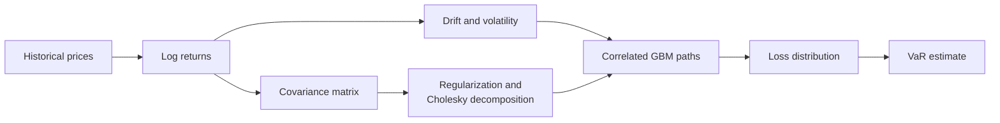

# A Multithreaded Java implementation of Monte Carlo simulation for Value-at-Risk estimation

A from-scratch quantitative risk engine that estimates **Value-at-Risk (VaR)** for a
multi-asset portfolio using **Monte Carlo simulation**, **geometric Brownian
motion** and **correlated asset returns**. The same numerical pipeline is
implemented three ways — a sequential reference, a data-parallel engine, and a
task-parallel fork-join hybrid — together with a benchmark harness for analyzing
execution time and speedup as thread count and input size change.

Built with the Java standard library only. No external dependencies.

## Highlights

- **End-to-end quantitative finance** — from historical prices and portfolio
  weights to a simulated loss distribution and VaR estimate.
- **Three concurrency designs** — a sequential baseline, explicit data
  parallelism, and a task-parallel fork-join hybrid.
- **Numerical rigor** — `BigDecimal` accumulation, controlled rounding,
  covariance regularization, and Cholesky decomposition.
- **Scalable randomness** — `SplittableRandom` streams and Box–Muller
  transforms eliminate contention between workers.
- **Performance-focused** — a built-in benchmark harness and scaling analysis;
  the accompanying paper reports more than 40× speedup on server-class hardware.

## How it works

1. **Estimate returns.** Historical asset prices are converted into logarithmic
   returns.
2. **Calibrate parameters.** Empirical means and standard deviations are
   annualized into drift and volatility estimates.
3. **Model dependence.** The asset covariance matrix is estimated, regularized
   to remain positive definite, and decomposed with Cholesky factorization.
4. **Simulate scenarios.** Correlated Gaussian shocks drive geometric Brownian
   motion paths for every asset, producing future portfolio values.
5. **Estimate risk.** Simulated losses are sorted and the VaR quantile is read
   at the configured confidence level.

## Implementations

| Variant | Entry point | Parallel model | Coordination |
| --- | --- | --- | --- |
| **Sequential baseline** | `sequential.MonteCarloSimulationSeq` | Single-threaded reference implementation | None |
| **Data-parallel** | `parallel1.MonteCarloSimulationMultithreaded` | Data parallelism and parallel loops across assets and simulation paths | `CountDownLatch`, `ExecutorService`, `Future` |
| **Task-parallel hybrid** | `parallel2.MonteCarloSimulationMultithreaded2` | Data parallelism plus task parallelism and the fork-join model | `CompletableFuture`, `ForkJoinPool`, parallel `IntStream` |

### `parallel1` — data parallelism with explicit synchronization

- Assets are partitioned into contiguous chunks for log returns, means,
  standard deviations, volatilities, drifts, and covariance rows.
- A `CountDownLatch` acts as a barrier at the end of every preprocessing stage.
- Portfolio initial value is computed through a fixed-size `ExecutorService`
  with `Callable`/`Future` tasks.
- Path simulation is divided into scenario ranges, one per worker.
- Each worker receives its own `SplittableRandom` stream to avoid contention.

### `parallel2` — data and task parallelism with fork-join

- Independent covariance, volatility, and initial-value branches run
  concurrently through `CompletableFuture` chains.
- A `ForkJoinPool` is sized to the requested thread count and provides
  work-stealing load balancing.
- Scenarios are generated with a parallel `IntStream`, allowing the pool to
  balance uneven chunks automatically.

### Shared engineering choices

- `BigDecimal` with `MathContext(20, HALF_UP)` is used where accumulation order
  and rounding matter.
- Gaussian shocks come from Box–Muller transforms over split random streams;
  the sequential baseline uses `Random.nextGaussian`.
- Both parallel engines use `Arrays.parallelSort` to order the loss
  distribution before the VaR quantile is read; the sequential baseline uses
  `Arrays.sort`.
- The covariance matrix receives a small ridge on its diagonal to improve
  numerical stability before Cholesky decomposition.

## Benchmarking

`Main.java` runs the sequential engine once, then both parallel engines for
every thread count from `1` to `Runtime.getRuntime().availableProcessors()`.
For each run it reports the VaR estimate, wall-clock duration, and speedup
relative to the sequential baseline.

Because the workload is dominated by path simulation, the harness makes it easy
to observe:

- how much of the pipeline actually parallelizes,
- where synchronization overhead overtakes useful work,
- how the two concurrency designs compare as core count increases,
- and how input size affects parallel efficiency.

All engines use the same portfolio and configuration, so their VaR estimates
also provide a numerical cross-check against one another.

## Research paper

A research paper was written based on this implementation. It presents the financial model,
both parallelization strategies and a detailed performance study covering execution time and speedup 
as functions of thread count and input size.

**Paper:** A multithreaded Java implementation of Monte
Carlo simulation for Value-at-Risk estimation ([https://annals-csis.org/Volume_49/drp/pdf/1699.pdf](https://annals-csis.org/Volume_49/drp/pdf/1699.pdf))

## Getting started

### Requirements

**JDK 22** with preview features enabled. The implementation uses Java 22 preview string templates together with modern `java.util.concurrent` APIs.

### Run

The harness reads the sample portfolio and simulation configuration from
`Main.java`, runs the sequential baseline, then sweeps both parallel
implementations across available thread counts. Each run reports the VaR
estimate, execution time, and speedup.

### Configuration

Portfolio prices, asset weights, confidence level, time horizon, simulation
count, and thread count are all defined in `Main.java`.

## Design notes

**Why `BigDecimal`?**

Financial calculations benefit from explicit precision and rounding control.
`BigDecimal` keeps accumulation and scaling decisions visible instead of
relying on implicit floating-point behavior.

**Why regularize the covariance matrix?**

Sample covariance matrices estimated from limited observations can be
ill-conditioned. A small ridge on the diagonal makes Cholesky factorization more
stable and keeps the simulation well-defined.

**Why split random streams?**

Giving every worker an independent `SplittableRandom` avoids lock contention and
preserves reproducibility of the parallel workload structure.

**Why parallel sorting?**

The VaR quantile depends on the order statistics of the loss distribution, so
sorting is a meaningful share of the runtime at large simulation counts.
`Arrays.parallelSort` keeps that stage parallel as well.

## Scope and limitations

This is an educational and portfolio-scale risk engine, not a production trading
or regulatory system. It assumes normally distributed log returns, a constant
covariance matrix, and no transaction costs or liquidity effects. It does not
model fat tails, stochastic volatility, or market impact. Those assumptions make
it well suited to demonstrating numerical and concurrent-programming techniques,
not to regulatory capital calculation.

## License

Copyright © 2026. All rights reserved.

All source code, documentation, and accompanying materials in this repository
are proprietary. No part of this repository may be reproduced, distributed,
modified, or used in any form without prior written permission from the
copyright holder. The repository is publicly available for viewing and
evaluation only.
